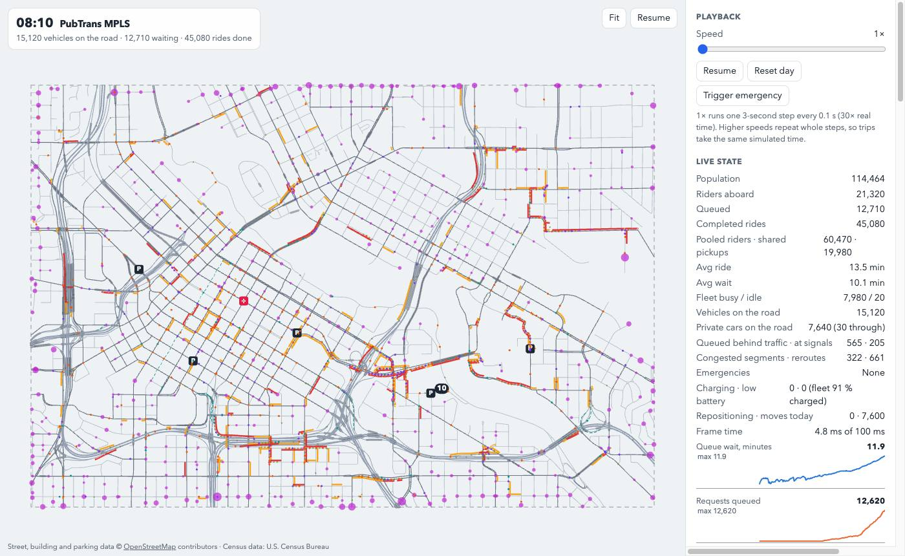
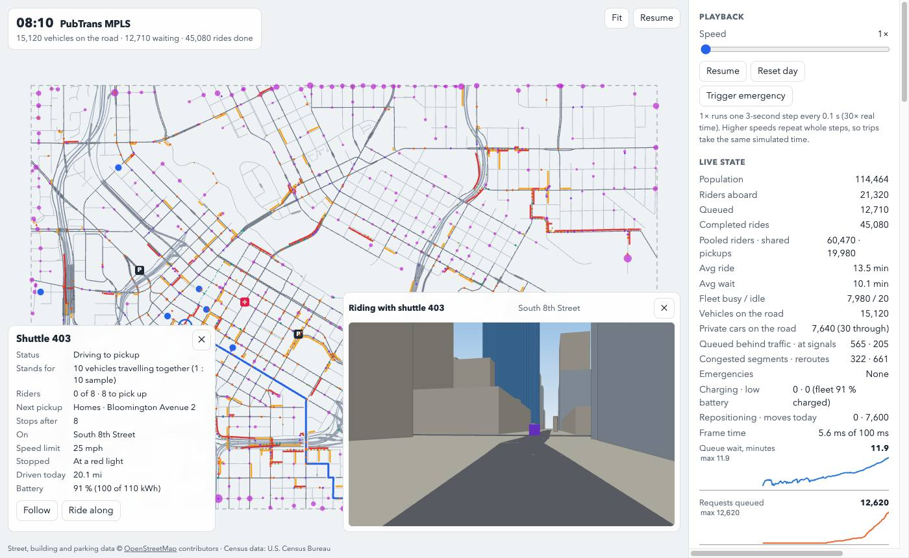
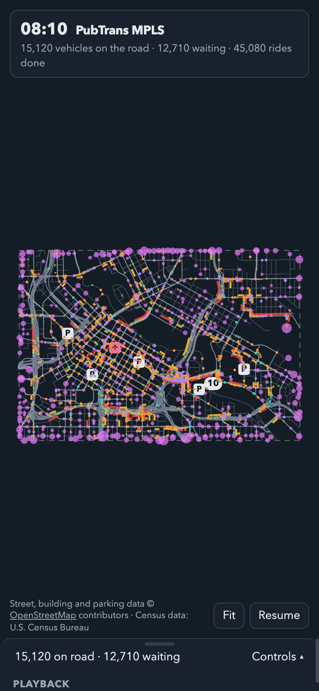
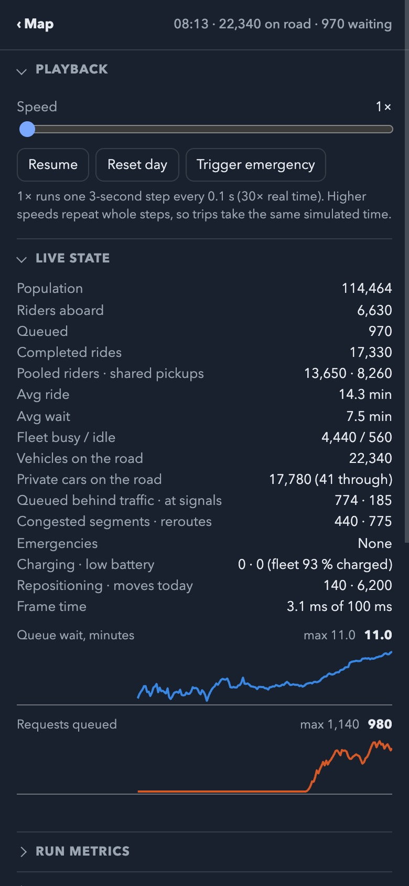
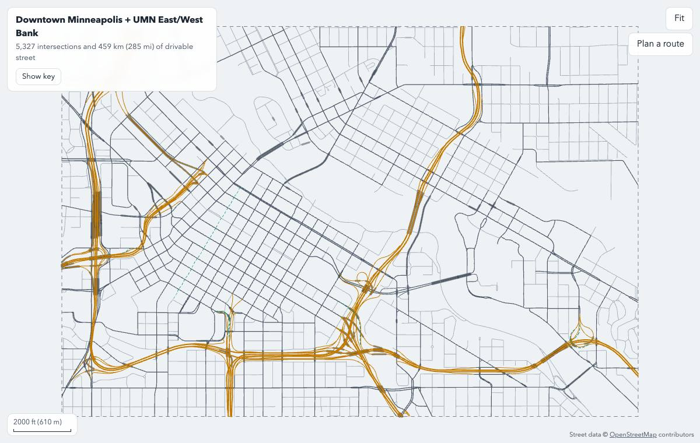

# PubTrans MPLS

What would downtown Minneapolis and the University of Minnesota look like if buses and many
private cars were replaced by self-driving electric (SDEV) shuttles? This simulation runs a
whole weekday of trips, built from the Census, on the real street network: SDEV sedans,
shuttles and buses dispatched to riders and pooling them, sharing the streets with the private
cars that remain and with freeway through-traffic, at signals that discharge at lane capacity.

**Live:** https://jsherman999.github.io/pubtrans_mpls_opus/ (simulation) ·
[street map](https://jsherman999.github.io/pubtrans_mpls_opus/viewer.html) ·
[original grid app](https://jsherman999.github.io/pubtrans_mpls_opus/source/index.html)



Adapted from [pubtrans_15_minute_city](https://github.com/jsherman999/pubtrans_15_minute_city)
(source commit `60774088fd727f49125c9bb2e979839fe8b3be2c`), which ran on a generated 6 × 6 grid.
The original app is kept at [`source/index.html`](source/index.html), unchanged except that on
phones its controls, live-metrics graph and debug stream are a second page swiped in from the
right, as on the other two pages; its
documentation is [`docs/SOURCE_README.md`](docs/SOURCE_README.md) and
[`docs/SOURCE_ARCHITECTURE.md`](docs/SOURCE_ARCHITECTURE.md).

- [What it models](#what-it-models)
- [Using the page](#using-the-page)
- [Results: how big a fleet?](#results-how-big-a-fleet)
- [Run locally](#run-locally)
- [Headless runs and sweeps](#headless-runs-and-sweeps)
- [Data builds](#data-builds)
- [Tests](#tests)
- [Limits](#limits)
- [Credits](#credits)

How it works: [ARCHITECTURE.md](ARCHITECTURE.md). How it was built, phase by phase, with the
measurements behind each step: [PLAN.md](PLAN.md). Data formats:
[docs/DATA_FORMAT.md](docs/DATA_FORMAT.md).

## What it models

- **The area:** downtown Minneapolis (North Loop to Elliot Park), Cedar-Riverside and the UMN
  West Bank, Nicollet Island, Marcy-Holmes, Dinkytown, the UMN East Bank and Stadium Village:
  a 6.1 × 4.1 km box with 5,327 intersections, 459 km of drivable street, 356 signal
  controllers, all eight Mississippi road bridges, and 205 roads leaving the map.
- **The people:** 114,000 residents and 226,000 jobs from the 2020 Census and LEHD LODES 2023
  (jobs that LODES files under one address, such as all of the university's, spread over the
  buildings nearby): commuters who arrive from the direction of their homes (and work from home
  on some days), hospital shifts, UMN students arriving for class and changing banks between
  classes, errands and visitors (optional), and an evening Twins game. About 690,000 trips on a
  Wednesday, with the surges where they should be.
- **The choice of mode:** today's modes first. Short trips are walked; longer ones are walked or
  cycled, driven or taken on transit in shares calibrated to the 2024 American Community Survey
  and fall 2025 Metro Transit boardings (about 109,000 transit trips a Wednesday touch the area).
  Then two levers: whether today's transit riders use SDEVs instead, and how many of today's car
  trips are still driven (90 % by default).
- **The fleet:** sedans (4 seats), shuttles (8) and buses (20), electric with batteries and
  charging, from five parking-ramp depots (open, close or add your own). Riders are pooled by
  area, picked up by vehicles already passing, and the idle fleet is rebalanced toward the next
  half hour's demand.
- **The streets:** lanes, one-ways, transit-only streets (Nicollet Mall, the Washington Avenue
  transitway) that SDEVs may use and cars may not, signals with green split by approach,
  saturation flow, queues that spill back, congestion that drivers route around, and police
  and fire emergencies that close streets.

## Using the page

Drag, scroll or pinch to move around the map. Tap a vehicle to see its riders and route, then
**Follow** it or **Ride along** in a driver's-seat view among the city's buildings (with the
IDS Tower, U.S. Bank Stadium, Target Center, Northrop, Coffman Union and Huntington Bank Stadium
modelled). Tap a stop to see who is waiting there.



The panel has (on phones it is a second full-screen page to the right of the map: swipe left
from the right edge, flick the map left or tap the **Stats & controls** tab to turn to it, and
swipe it right or tap **‹ Map** to go back; a slow drag still pans the map):

- **Playback:** speed from 1× (30× real time) up, reset, trigger an emergency.
- **Scenario:** day of the week, people per agent, share of car trips kept, transit replaced or
  kept, pooling, fleet size by vehicle type, depots, battery-electric operation, rebalancing.
- **Live state** with charts of wait and queue, **Run metrics** (fleet and car miles and hours,
  empty share, occupancy, utilisation, wait and ride percentiles) with CSV downloads, the
  **Chokepoints** (river bridges, freeway ramps, map-edge entries) and an event log.

 

`viewer.html` is the street map on its own: tap a street for its speed, lanes, direction and
OSM way, or **Plan a route** to compare the fastest car route with the fastest shuttle route.
On phones the area summary, key and links are a second page beside the map, reached the same
way as the simulation's panel (the **Info & key** tab, a swipe from the right edge or a flick).



## Results: how big a fleet?

A Wednesday morning, 05:30–10:00, a tenth of today's car trips moved to SDEVs, simulated at
1:5 (each rider and fleet agent stands for five), recorded in [`docs/results/`](docs/results/).
The average wait counts every rider since 05:30, those still waiting at 10:00 included.

| Transit kept (15,700 ride requests) | 500 | 1,000 | **1,500** | 2,000 | 3,000 |
|---|---|---|---|---|---|
| Average wait (min) | 35.3 | 15.3 | **9.8** | 8.7 | 6.5 |
| Riders delivered | 11,840 | 14,680 | 15,115 | 15,200 | 15,245 |

| Transit replaced too (50,000 ride requests) | 1,000 | 2,000 | 3,000 | 4,000 | **5,000** | 6,000 |
|---|---|---|---|---|---|---|
| Average wait (min) | 46.9 | 24.5 | 16.6 | 11.4 | **9.1** | 8.9 |
| Riders delivered | 26,525 | 36,070 | 39,900 | 41,810 | 42,265 | 41,440 |

- **Keeping today's transit**, about **1,500 vehicles** carry a tenth of today's car trips with
  a 10-minute average wait.
- **Replacing transit as well**, requests peak at about 17,000 an hour (5,200 in the busiest
  15 minutes, as people leave for 8:00 work and classes). About **5,000 vehicles** give a
  9-minute average wait; more barely help, because rides average 25 minutes: most riders come
  from outside the area and board at transfer points on its edge, and pooled rides stop on the
  way. The page defaults to 5,000 vehicles.

These replace earlier results (4,000 and 8,000+ vehicles) from a demand model that counted
everyone who did not drive as a transit rider and stacked whole employers on single blocks; it
asked for 3.5 times as many rides as the counts support. "Phase 10" in [PLAN.md](PLAN.md) has
the calibration and its sources.

## Run locally

No build step and no dependencies. Serve the folder and open it:

```
python3 -m http.server 8000
```

- http://localhost:8000 — the simulation
- http://localhost:8000/viewer.html — the street map
- http://localhost:8000/source/index.html — the original grid app

The pages also open straight from the file system (`file://`).

## Headless runs and sweeps

The same engine runs in Node (18 or later), seeded, for scenario runs and sweeps:

```
node tools/run_scenario.cjs --until 10:00 --fleet 5000 --out-dir results/base
node tools/run_scenario.cjs --vary fleet=500,1000,1500,2000 --keep-transit --sampling 5 --out-dir results/sweep
```

A single run writes `summary.csv` (fleet and car miles and hours, empty share, occupancy,
utilisation, wait and ride percentiles, energy), `series.csv` (every 15 minutes),
`bridges.csv` (hourly crossings of the eight river bridges by direction) and
`distributions.csv` (riders by minutes waited and ridden). `--vary fleet|carShare|pooling|sampling|day`
runs one scenario per value and adds `sweep.csv` and `sweep.svg` (average wait and riders
delivered against the varied setting). Other options: `--mix sedans,shuttles,buses` (shares),
`--car-share 0-1`, `--keep-transit`, `--pooling 0-100`, `--day 0-6` (Monday = 0), `--seed`,
`--no-ev`, `--no-rebalance`. The page's Run metrics panel downloads the same CSVs.

`tools/fleet_sweep.cjs` searches for the smallest fleet that meets a target wait:

```
node tools/fleet_sweep.cjs --totals 3000,4000,5000,6000 --until 10:00 --target 10 --out data/fleet_sweep.json
node tools/fleet_sweep.cjs --totals 1000,1500,2000 --keep-transit
```

## Data builds

The data in `data/` is generated by three offline builds (Python 3, standard library only) and
committed, so nothing here needs to run to use the pages. Each needs network access with
`--fetch`, saves its raw downloads to `data/raw/` (not committed), and writes a report to review.

```
python3 tools/build_osm.py --fetch         # streets   -> data/mpls_graph.js      (541 KB)
python3 tools/build_buildings.py --fetch   # buildings -> data/mpls_buildings.js  (573 KB)
python3 tools/build_demand.py --fetch      # Census    -> data/mpls_demand.js     (224 KB; uses the buildings)
```

Rebuild from saved downloads by leaving out `--fetch` (`build_osm.py` takes
`--input data/raw/osm_roads.json`). The study box is the `--bbox S W N E` option of each build.

## Tests

```
python3 -m unittest discover -s tests -p "test_*.py"   # street, demand and building pipelines
node tests/viewer.test.cjs                             # decoder and street viewer
node tests/routing.test.cjs                            # router, signals, 7,000-node benchmark
node tests/motion.test.cjs                             # vehicle motion, up to 3,400 vehicles
node tests/sim.test.cjs                                # engine on the real network
node tests/congestion.test.cjs                         # capacity, congestion, AM peak
node tests/demand.test.cjs                             # Census demand, daily totals, AM/PM shape
node tests/fleet.test.cjs                              # scenario controls, fleet at scale, sweep
node tests/pov.test.cjs                                # buildings, landmarks, driver view
node tests/metrics.test.cjs                            # run metrics, CSV export, scenario runner
node tests/page.test.cjs                               # simulation page, headless
node tests/pages.test.cjs                              # phone pages in the original grid app
node tests/publish.test.cjs                            # assets, links, attribution, size budgets
node tests/simulation.cjs                              # original grid app (slow, ~2 minutes)
```

## Limits

This is an illustrative model, not a calibrated forecast.

- Trip timing, mode shares, hybrid work and student travel are modelled from Census counts and
  calibrated to published totals (ACS commuting, Metro Transit boardings, UMN and Downtown
  Council figures; see [PLAN.md](PLAN.md), Phase 10), not fitted to a travel survey.
- Riders from outside the area board at a transfer point on its edge, so their rides inside the
  area are long; their trips beyond the edge are not simulated.
- Road capacity uses lanes and saturation flow by road class; turn lanes, signal coordination
  and pedestrians are not modelled. Light rail is not modelled.
- People outside the box appear only as trips crossing its edge.
- Most parking capacities are estimated from footprints, and most building heights are
  defaults by building type.
- Agents stand for groups of people and vehicles (1:10 on the page); pooling at coarser
  sampling sees a sparser demand than reality.
- Phones have not been timed on a device; the morning peak at 20× may be slow on older phones.

## Credits

- Street, building and parking data © [OpenStreetMap](https://www.openstreetmap.org/copyright)
  contributors, available under the Open Database License (ODbL).
- Population and housing: U.S. Census Bureau, 2020 Census (P.L. 94-171), through TIGERweb.
  Jobs and commutes: U.S. Census Bureau, LEHD Origin-Destination Employment Statistics (LODES)
  2023. Public domain.
- Simulation design from [pubtrans_15_minute_city](https://github.com/jsherman999/pubtrans_15_minute_city).
